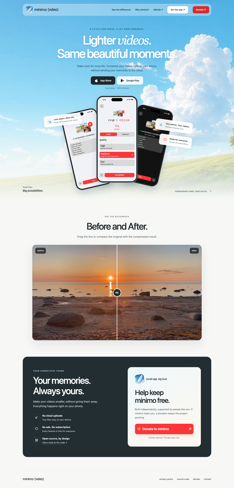

# minimo (video) — website

The landing page for **minimo (video)**, a free, open-source app that compresses videos on your phone. No cloud uploads, ads, or subscriptions.

[Website](https://minimo-video.vercel.app/) · [App Store](https://apps.apple.com/us/app/minimo-video/id6787456951) · [Google Play](https://play.google.com/store/apps/details?id=com.khlebobul.minimo_video) · [App source](https://github.com/minimo-pro/minimo_video) · [Donate](https://web.tribute.tg/d/PM3)



The page includes real app screenshots against a sky background, links to both stores, an interactive before/after video comparison, and a privacy and donation section. Donations are optional; the app stays free.

## Run locally

No dependencies or build step. From the project directory:

```sh
python3 -m http.server 4173
```

Open [localhost:4173](http://localhost:4173). The privacy page is available locally at `/privacy.html`.

## Files

- `index.html` — landing page; a small inline script controls the comparison slider.
- `styles.css` — shared styles, mobile layouts, and reduced-motion support.
- `privacy.html` — app privacy policy.
- `assets/` — app screenshots, sky background, icon, font, and comparison videos.
- `favicon/` — browser and home-screen icons.
- `screenshots/github.png` — current website preview.
- `vercel.json` — clean URLs; the deployed privacy page uses `/privacy`.

Screenshots and the sky background come from the companion `minimo_video` app project. Store logos come from [Simple Icons](https://simpleicons.org/) ([CC0 license](assets/simple-icons-LICENSE.md)). Website analytics use Umami; app videos are processed on the device.

## Deploy

Serve this directory as a static site. Vercel needs no build command; `vercel.json` enables clean URLs. Other hosts must map `/privacy` to `privacy.html`.
